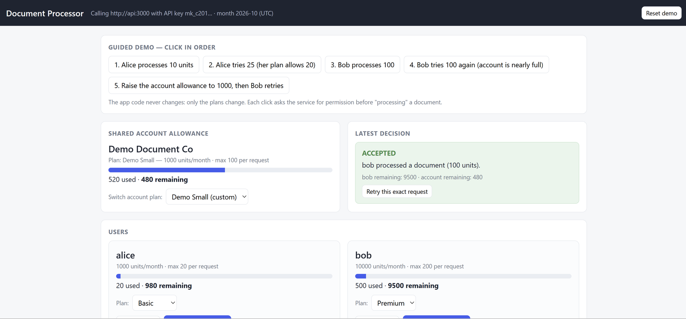
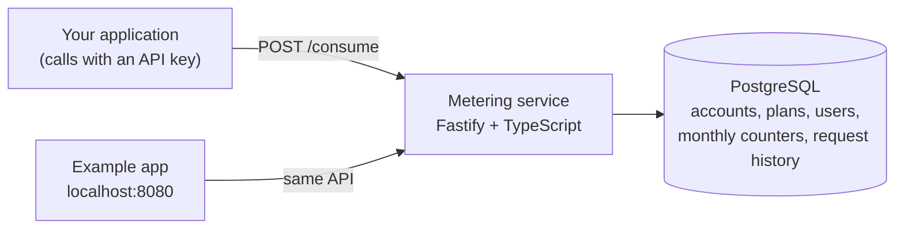
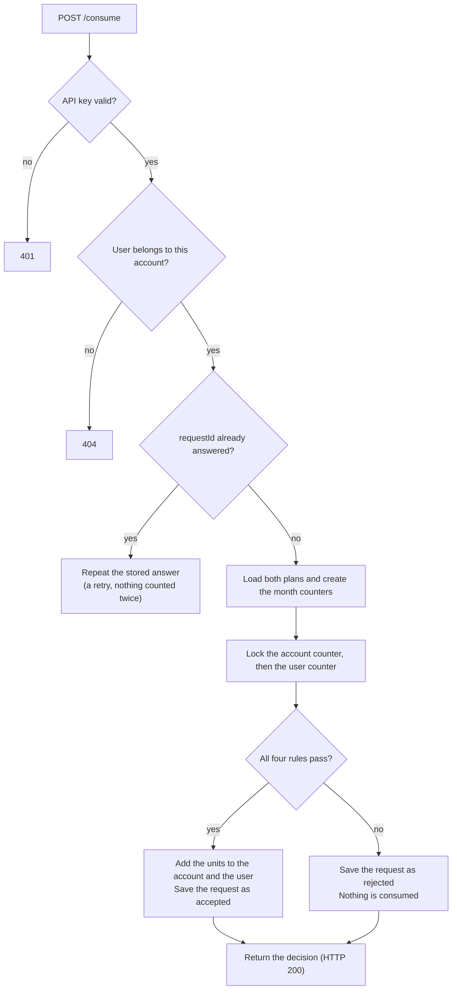

# Usage Metering and Quota Service

A backend service that other applications call to track usage and decide whether their users may perform an action. Every account has a shared monthly allowance and every user has an individual one. Before doing work, the calling application asks this service to consume units. The service checks **both** plans, records the decision, and counts the units only if everything allows it.

- **Stack:** TypeScript, Fastify, PostgreSQL, drizzle ORM, zod, Vitest, autocannon
- **One service, one database, plus an example client**, all started with Docker Compose
- Plans can be changed at any time through the API and apply to the very next request, with no redeploy

## Quick start

Requirements: Docker Desktop (running).

```bash
docker compose up --build
```

| What | Where |
|---|---|
| Metering API | http://localhost:3000 (`GET /health`) |
| Example application (web page) | http://localhost:8080 |
| PostgreSQL (for inspection) | localhost:5433, user/password/db all `metering` |

Database tables and the predefined plans are created automatically on startup (migrations plus an idempotent seed). Data lives in the `pgdata` Docker volume, so it survives restarts. `docker compose down` keeps it; `docker compose down -v` wipes it.

### Try the example application

Open http://localhost:8080. The app holds an account API key on its own server side and calls the service on behalf of two users, **alice** (Basic plan) and **bob** (Premium plan). Click the five guided steps in order:

1. Alice processes 10 units: **accepted**.
2. Alice tries 25: **rejected by the user's per-request limit** (her plan allows 20).
3. Bob processes 100: accepted.
4. Bob tries 100 again: **rejected by the shared account allowance**, even though Bob himself has 9,900 units left.
5. The account allowance is raised to 1000 and Bob retries: **accepted**. The client code did not change; only the plan did.


*A request rejected by the shared account allowance: bob still has 9,100 units, but the account has only 80 left.*



*An accepted request: the balances of the user and of the account both go down.*

The page shows every decision, the remaining allowance of the account and of each user, the plans, and recent request history. You can also switch the plan of any user or of the account, create custom plans, edit custom plans, and press "Retry this exact request" to see that a retry is not counted twice. "Reset demo" starts a fresh account.

The same flow as a script (Windows PowerShell), against the running API: `.\scripts\demo.ps1`

## Concepts

| Concept | Meaning |
|---|---|
| Account | An application or company calling the service. Its **account plan** limits are shared by all its users. |
| User | A user of that application, registered under one account. Its **user plan** limits are individual. |
| Plan | A named set of rules: a monthly allowance and a maximum per request. Assigned to an account or to a user. |
| Units | The single resource being metered (for example document-processing credits). |

Both plans always apply together. Giving a user a larger allowance never increases the account's shared allowance. The account's usage is the sum of the accepted usage of its users.

### Predefined plans

Created at startup, read-only, available to every account.

| Plan | Type | Units per month | Max units per request |
|---|---|---|---|
| Starter | account | 10,000 | 100 |
| Pro | account | 100,000 | 1,000 |
| Basic | user | 1,000 | 20 |
| Premium | user | 10,000 | 200 |

New accounts start on **Starter**; new users start on **Basic**.

### Rules

Two rule types, for both account and user plans:

- **Monthly allowance:** total units available in a UTC calendar month.
- **Maximum per request:** the largest amount one request may consume.

A request is accepted only if all four checks pass (user per-request, account per-request, user monthly, account monthly). A rejection consumes nothing.

Worked examples (account: 10,000/month and 100 per request; user: 1,000/month and 20 per request):

- 25 units: rejected by the **user's** per-request limit, even though both monthly allowances have room.
- 10 units with both allowances having room: accepted, adds 10 to the user and 10 to the account.
- 10 units when the account has only 5 left: rejected by the **account's** monthly allowance, even if the user has plenty.

## API keys and account isolation

1. `POST /accounts` creates an account and returns its API key **once**.
2. Send the key in the `x-api-key` header on every other call.
3. A missing or invalid key returns `401`.
4. The key identifies the calling account and gives access only to that account's data. Users, plans, usage and history of other accounts are never visible: they return `404`, exactly as if they did not exist. This includes using another account's custom plan.

Only a SHA-256 hash of the key is stored. A lost key cannot be recovered (see limitations).

## API reference

All bodies are JSON. Errors always look like `{ "error": "<code>", "message": "<human readable>" }`; validation errors add a `details` array.

On Windows PowerShell use `curl.exe` (plain `curl` is an alias for something else), or see `scripts/demo.ps1`.

### Accounts and users

| Method and path | Purpose |
|---|---|
| `POST /accounts` | Create an account (no key needed). Body: `{ "name": "Acme", "planName": "Starter" \| "Pro" }` (`planName` optional). Returns `201` with `apiKey`. |
| `GET /account` | The calling account and its current plan. |
| `PUT /account/plan` | Switch the account plan. Body: `{ "planId": "<uuid>" }`. Must be an account plan that is predefined or owned by this account. |
| `POST /users` | Register a user. Body: `{ "externalId": "alice", "planId": "<uuid>" }` (`planId` optional, default Basic). `409 user_exists` if the id is taken in this account. |
| `GET /users/:externalId` | A user and the plan applied to them. |
| `PUT /users/:externalId/plan` | Change a user's plan. Body: `{ "planId": "<uuid>" }`. Consumed units are kept. |

`externalId` is the identifier your application already uses for the user. It only has to be unique inside one account.

### Plans

| Method and path | Purpose |
|---|---|
| `GET /plans` | Predefined plans plus this account's own plans. This is how callers inspect the limits that apply. |
| `POST /plans` | Create a custom plan. Body: `{ "name", "type": "account" \| "user", "monthlyAllowance": 0.., "maxPerRequest": 1.. }`. |
| `PUT /plans/:id` | Update a custom plan (any of `name`, `monthlyAllowance`, `maxPerRequest`). Predefined plans return `403 predefined_plan_read_only`. Applies to every account or user using it, from the next request. |

Several users may share one plan definition; each keeps separate usage.

### Consuming units

`POST /consume`

```json
{ "userId": "alice", "units": 10, "requestId": "doc-8f3a" }
```

- `userId`: the user's `externalId`, must belong to the calling account (`404 user_not_found` otherwise).
- `units`: a positive whole number.
- `requestId`: chosen by the caller, unique per logical action. This is what makes retries safe.

A **decision is always HTTP 200**; read the `accepted` field. 4xx is reserved for bad input, unknown users, and reused request ids.

Accepted:

```json
{
  "accepted": true,
  "replayed": false,
  "requestId": "doc-8f3a",
  "userId": "alice",
  "units": 10,
  "month": "2026-10",
  "rejection": null,
  "violations": [],
  "account": { "plan": { "id": "…", "name": "Starter" }, "limits": { "monthlyAllowance": 10000, "maxPerRequest": 100 }, "consumed": 10, "remaining": 9990 },
  "user":    { "plan": { "id": "…", "name": "Basic" },   "limits": { "monthlyAllowance": 1000,  "maxPerRequest": 20  }, "consumed": 10, "remaining": 990 }
}
```

Rejected (25 units against a per-request limit of 20):

```json
{
  "accepted": false,
  "replayed": false,
  "rejection": {
    "level": "user",
    "rule": "max_per_request",
    "message": "Requested 25 units, but the user plan allows at most 20 units per request."
  },
  "violations": [ { "level": "user", "rule": "max_per_request" } ],
  "account": { "consumed": 10, "remaining": 9990, "…": "…" },
  "user":    { "consumed": 10, "remaining": 990,  "…": "…" }
}
```

`rejection.level` is `account` or `user`; `rejection.rule` is `max_per_request` or `monthly_allowance`. When several rules are broken, `rejection` shows the first in this fixed order: user per-request, account per-request, user monthly, account monthly. `violations` lists all of them.

### Usage and history

| Method and path | Purpose |
|---|---|
| `GET /usage?month=2026-10&limit=50&offset=0` | Consumed and remaining for the account and for each of its users (default: current UTC month). |
| `GET /usage/months` | Months that have usage, newest first, for browsing previous months. |
| `GET /users/:externalId/usage?month=…` | One user's usage and the account's usage for that month. |
| `GET /requests?page=1&pageSize=20&month=…&userId=…` | Request history (accepted and rejected), newest first, paginated, with the rejecting rule. |

`remaining` is never negative.

### Example

```bash
# 1. Create an account (save the apiKey from the response)
curl -s -X POST localhost:3000/accounts -H "content-type: application/json" -d '{"name":"Acme"}'

# 2. Register a user
curl -s -X POST localhost:3000/users -H "x-api-key: $KEY" -H "content-type: application/json" -d '{"externalId":"alice"}'

# 3. Consume units
curl -s -X POST localhost:3000/consume -H "x-api-key: $KEY" -H "content-type: application/json" \
  -d '{"userId":"alice","units":10,"requestId":"doc-1"}'

# 4. Inspect usage
curl -s localhost:3000/usage -H "x-api-key: $KEY"
```

## Changing plans

- A plan change applies to **new requests after the update succeeds**. Editing a custom plan changes every account or user using it.
- **Consumed units are preserved.** Switching plans never grants a fresh monthly allowance, because usage is stored per user and per month, separately from the plan.
- If an allowance is reduced below existing usage, `remaining` shows **0** and further requests are rejected at that level until the allowance rises again.
- Request history is never rewritten by plan changes.

## Retries and safe handling of duplicates

`requestId` makes `POST /consume` idempotent per account:

- Sending the same `requestId` again returns the **stored decision** with `"replayed": true` and the current balances. Nothing is counted twice.
- This also holds when the identical request is sent many times at the same moment (tested with 30 in parallel).
- The same `requestId` with a different user or units returns `409 request_id_reused`.
- Two different accounts may use the same `requestId` independently.
- A rejected decision is stored too. Retrying it returns the same rejection, even if limits changed in the meantime. To try again after a plan change, send a **new** `requestId`.

## Product assumptions

Choices made where the brief left the behaviour open:

1. **Decisions are HTTP 200.** A rejection is a valid answer, not an error; callers read `accepted`.
2. **Months are UTC calendar months**, taken from the server clock at the moment the request is processed. Counters are stored per month, so a new month starts at zero and old months stay queryable.
3. **Rejected requests are recorded in history** and reserve their `requestId`, so retries are consistent.
4. **Evaluation order** for the reported rejection reason is fixed (user per-request, account per-request, user monthly, account monthly), and all broken rules are also listed in `violations`.
5. **Account creation is open** (no key needed), since it is how a key is issued and admin roles are out of scope.
6. **Plans belong to one account** and cannot be shared across accounts. Plan names are not unique. A user plan cannot be assigned to an account or the reverse.
7. **Predefined plans are read-only**; custom plans can be edited but not deleted. Users cannot be deleted or moved between accounts.
8. **Limits:** `monthlyAllowance` may be 0 (blocks the level) and `maxPerRequest` must be at least 1. Units and limits are whole numbers up to 2,147,483,647.
9. **Plan edits during traffic:** a request already being evaluated when an edit commits may still use the previous values; every request that starts after the edit uses the new ones.
10. **Users are addressed by `externalId`**, the caller's own identifier, not by an internal id.

## Design



### Data model

| Table | Holds |
|---|---|
| `accounts` | name, hashed API key, current account plan |
| `plans` | allowance and per-request limit; `account_id` is null for predefined plans |
| `users` | belongs to an account, `external_id` unique per account, current user plan |
| `account_usage` | consumed units per (account, month) |
| `user_usage` | consumed units per (user, month) |
| `requests` | one row per decision (accepted or rejected), unique per (account, request id) |

Key choices:

- **Stored counters instead of `SUM()` over history.** Reading and checking a limit is a single-row lookup that does not slow down as history grows, and it is what the locks protect.
- **Usage is separate from plans.** That is why switching a plan preserves usage and why lowering an allowance behaves predictably.
- **A unique constraint on (account, request id)** is the last line of defence for idempotency, even if application logic had a bug.

### How a consume request is processed



Trace of `POST /consume`: `src/api/auth.ts` (API key) → `src/api/consume.ts` (validation) → `src/services/consume.ts` (the steps below) → `src/domain/rules.ts` (the four rules). The code in `consume.ts` is written as numbered steps on purpose, so it reads like a recipe.

1. **Find the user.** The user must belong to the calling account, otherwise `404`.
2. **Is it a retry?** If this `requestId` was already answered, repeat that stored answer. No lock is needed: stored answers never change.
3. **Load the two plans** (the account plan and the user plan currently assigned).
4. **Make sure this month's two counters exist** (created at zero when missing).
5. **Open a transaction.** Everything below fully happens or not at all:
   1. Lock the account's counter row for this month (`SELECT … FOR UPDATE`). While it is held, no other request of the same account can run, so two requests can never spend the same units. Different accounts do not wait for each other.
   2. Lock the user's counter row. The order is always account first, then user, so two requests can never wait for each other forever (no deadlock).
   3. Check again for a retry: an identical request may have finished while this one waited for the lock.
   4. Check the four rules with the pure function in `rules.ts`.
   5. If accepted, add the units to the account counter and to the user counter.
   6. Always save the request in the history, accepted or rejected.
   7. Commit and return the decision.

The plans are read just before the lock (step 3). A request that started before a plan edit committed may therefore still use the old limits, which is product assumption 9; every request that starts after the edit uses the new ones.

### Other decisions

- Migrations (`drizzle/`) and the predefined-plan seed run automatically at startup; the seed can run repeatedly without duplicating plans.
- API keys are `mk_` plus 48 random hex characters, stored as SHA-256 hashes, shown once.
- Validation with zod gives precise `400` errors; storage errors such as duplicate users map to `409`.
- The database connection pool is 20 (`DB_POOL_MAX`), because each in-flight transaction needs its own connection.

## Tests

39 automated tests cover the rules, API key validation, account isolation, the four limits, retries, plan changes, month rollover, history, and concurrency.

```bash
docker compose up -d db
npm install
npm test
```

They call the app directly (no server needed) against the Postgres from Compose on port 5433, and create fresh accounts each run so earlier data never interferes. If you see `ECONNREFUSED ... 5433`, the database is not running: start Docker Desktop and run `docker compose up -d db`. What is covered:

- Missing and invalid API keys on every protected route; one account can never read, use, or change another account's users, plans, usage or history.
- All four rules, including the brief's examples (25 units against a 20 limit; 10 units with 5 left on the account); users sharing a plan keep separate totals; rejections consume nothing.
- Retries return the stored decision and count once; reusing a `requestId` with different units returns 409.
- Switching plans preserves usage; editing a custom plan changes the next request; lowering an allowance below usage gives `remaining` 0; predefined plans are read-only.
- A new UTC month starts at zero while previous months stay queryable (clock is faked across a month boundary).
- **Concurrency:** 200 parallel requests against an account allowance of 100 accept exactly 100; 100 parallel requests against a user allowance of 50 accept exactly 50; the same `requestId` sent 30 times in parallel counts once; a plan edit during traffic never corrupts totals.

## Performance

### How it was tested

`load-tests/run.mjs` uses [autocannon](https://github.com/mcollina/autocannon) against the full Docker Compose stack. Each scenario runs 50 parallel connections for 10 seconds, 1 unit per request, and afterwards verifies the accounting through the API.

| Scenario | What it shows |
|---|---|
| A. One account, 50 users, all accepted | Throughput of a single hot account (its requests are serialized by its lock) |
| B. 20 accounts × 5 users, all accepted | Different accounts working in parallel |
| C. One account capped at 1000 units | Correctness under pressure: exactly 1000 may ever be accepted |
| D. Same request ids repeated | Retries: nothing counted twice |

Reproduce (needs Docker and Node.js):

```bash
docker compose up -d --build
npm install
node load-tests/run.mjs my-label      # writes load-tests/results-my-label.md
```

Environment of the results below: Intel Core i7-8850H (12 logical CPUs), 15.5 GB RAM, Windows 11, Docker Desktop, Node v24.21.0. The load generator, the service and Postgres all share this one laptop, so absolute numbers are conservative. Compare before and after, not the raw values. Each number is one 10-second run, so differences of roughly 10 to 20 percent between runs are noise.

### Results

Full output is committed in `load-tests/`: `results-baseline.md` (first version), `results-final.md` (the version in this repository) and `results-optimized.md` (an experimental faster version, see below).

| Scenario | Baseline req/s | Final req/s | Speed-up | p99 baseline → final (ms) |
|---|---|---|---|---|
| A. One account | 32 | 120 | 3.8× | 2122 → 784 |
| B. 20 accounts | 89 | 214 | 2.4× | 1057 → 352 |
| C. Capped at 1000 | 41 | 147 | 3.6× | 1389 → 586 |
| D. Retries | 46 | 414 | 9.0× | 1292 → 152 |


There were zero errors, and **every correctness check passed in every run**: account totals always equal the sum of their users, no allowance was exceeded, and each repeated request id was counted exactly once. In scenario C the baseline never reached the cap (only 412 requests), while the final version did and accepted **exactly 1000 units**, no more.

### What the baseline showed

- Even scenario D (retries, which only read a stored decision) managed only 46 req/s, so the cost was not the business logic. It was the number of **database round trips per request** (15 for an accepted request), all inside one transaction that **held the account lock the whole time**. Round trips are noticeably slower through Docker Desktop on Windows, so each request kept the account locked for about 30 ms.
- Requests of one account are serialized by design (that is what keeps the shared total exact), so throughput for one account is roughly 1 divided by the time the lock is held. Scenario B ran faster because different accounts do not wait for each other.

### What was changed (without touching the rules)

The idea: do as much as possible **before** taking the lock, so the lock is held for less time.

1. Retries are answered before the transaction starts, with no lock at all. Stored decisions never change, so this is safe.
2. The user and both plans are loaded before the lock instead of inside it.
3. This month's counter rows are created before the lock, not inside it.
4. The connection pool was raised from 10 to 20 (each in-flight transaction needs its own connection).

Round trips per request that happen while the lock is held:

| Request type | Baseline | Final |
|---|---|---|
| Accepted | 15 | 8 |
| Rejected | 13 | 6 |
| Retry of a stored decision | 14 | 0 (7 round trips in total, none under a lock) |

These were counted by instrumenting the database client during development.

Correctness is preserved because the lock order (account, then user) is unchanged, the request id is re-checked after the lock is taken, and the 39 tests (including the concurrency ones) and the correctness checks of the load test pass on the final code.

### A faster version that was not kept

A faster experimental version was also built and measured (A 103, B 250, C 129, D 815 req/s; see `results-optimized.md`). It fetched everything with one hand-written SQL query and changed three tables with one statement. It was **deliberately not kept**: the author must be able to explain every line of the code. The simple final version is within run-to-run noise of it for scenarios A and C, about 15 percent slower for B, and half as fast for retries. That is a small price for code that reads as a list of steps. The experimental code is in the git history (commit "perf: fewer database round trips in /consume, lock-free replay of stored decisions").

### What is still the bottleneck

A single account is limited to roughly 120 requests per second on this machine (about 8 ms of lock time per request). That is inherent to keeping a shared total exact with row locks. Scenario B reaches about 214 req/s, not 20 times more, so another limit also applies there (the Node process is a single thread, and the generator, API and database share one laptop); this was not profiled further.

## Known limitations

- **Hot accounts:** all requests of one account are processed one after another. This favours exactness over peak throughput for a single very busy account. Ideas for later: batching counter updates, or sharding an account's allowance across several counters at the cost of exactness.
- **API keys:** no rotation, revocation or recovery endpoint; account creation is open (no admin authentication or rate limiting).
- **No deletion** of users, plans or accounts, and no way to move a user to another account.
- **Rejected decisions are replayed** for the same `requestId`; a caller that wants to retry after a limit change must send a new id.
- **History** uses offset pagination, which gets slow for very deep pages, and grows without limit (no archiving).
- **Time** comes from the API server's clock. With several API instances, clock differences could assign a request near midnight UTC to different months.
- **One service, one database**: no replication or failover, as stated by the brief's scope.
- **Load numbers** come from one laptop with everything on the same machine, one run per scenario; they show relative improvement, not production capacity.
- Automated tests share the development database and leave their data behind.

## Project layout

```
src/
  index.ts            startup: migrations, seed, server
  app.ts              routes and error handling
  api/                auth, accounts, users, plans, consume, usage (HTTP layer)
  services/           consume (accounting), plans, apiKeys
  domain/rules.ts     pure rule evaluation, no database
  db/                 schema, pool, migrations runner, seed
drizzle/              generated SQL migrations
client/               example application (server, page, Dockerfile)
tests/                Vitest tests
load-tests/           load test script and committed results
scripts/demo.ps1      scripted demo against the running API
docs/images/          charts and screenshots used in this README
docker-compose.yml    db + api + client
```
