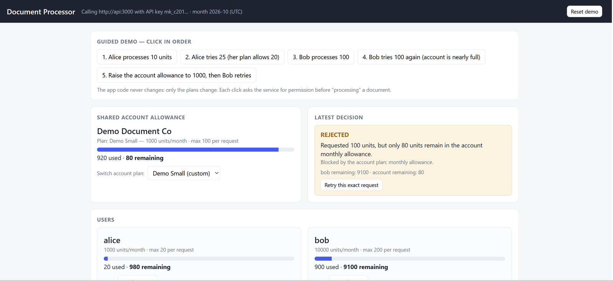
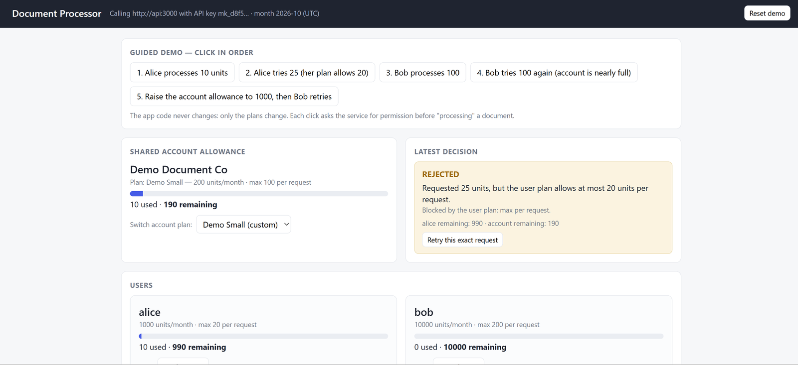
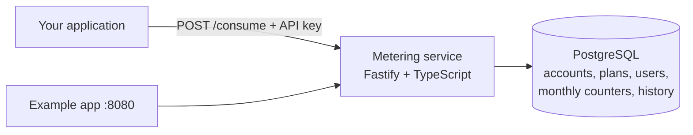
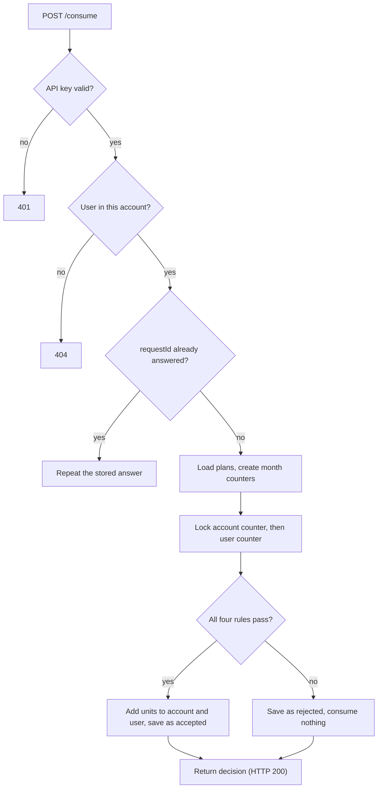
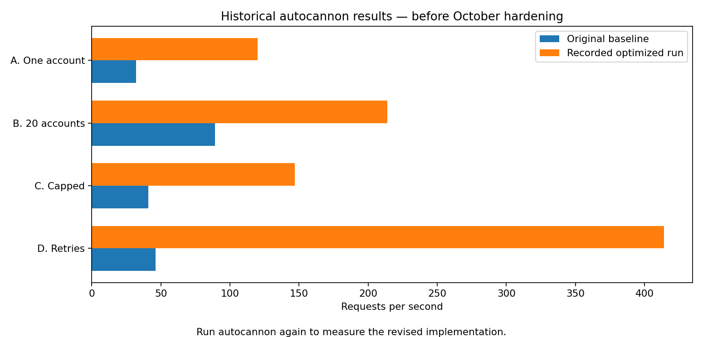

# Usage Metering and Quota Service

A backend service that other applications call to track usage and decide whether their users may perform an action. An account has a shared monthly allowance and each user has an individual one. Before doing work, the application asks the service to consume units. The service checks **both** plans, records the decision, and counts the units only if everything allows it. Plans can be changed through the API and apply to the very next request, with no redeploy.

**Stack:** TypeScript, Fastify, PostgreSQL, drizzle ORM, zod, Vitest, autocannon. One service, one database, one example client.

## Quick start

```bash
docker compose up --build
```

| What | Where |
|---|---|
| Metering API | http://localhost:3000 (`GET /health`) |
| Example application | http://localhost:8080 |
| PostgreSQL | localhost:5433, user, password and database all `metering` |

Tables and the predefined plans are created automatically on startup. Data lives in a Docker volume and survives restarts (`docker compose down -v` wipes it).

### The example application

The example app holds an account API key on its own server and calls the service on behalf of two users: **alice** (Basic plan) and **bob** (Premium plan). Click the five guided steps in order: alice is accepted; alice is rejected by her own per-request limit; bob is accepted; bob is rejected by the **shared account allowance** even though he has plenty left; the account allowance is raised and the same request from bob is accepted. The client code never changes, only the plans do. The page also lets you switch plans, create and edit custom plans, and retry a request to see it is not counted twice. The same flow runs as a script with `.\scripts\demo.ps1` (PowerShell).

| Rejected by the shared account allowance | Rejected by the user's own limit |
|---|---|
|  |  |

## Concepts and rules

An **account** is the calling application (its plan is shared by all its users). A **user** is registered under one account (its plan is individual). A **plan** is a named set of rules, assigned to an account or to a user. **Units** are the single resource being metered. Both plans always apply together; a bigger user allowance never increases the account's.

Two rules per plan: a **monthly allowance** (UTC calendar month) and a **maximum per request**. A request is accepted only if all four checks pass (user per-request, account per-request, user monthly, account monthly). A rejection consumes nothing. Examples with the Starter and Basic plans: 25 units is rejected by the **user's** per-request limit (20) even if both allowances have room; 10 units when the account has only 5 left is rejected by the **account's** allowance even if the user has plenty.

Predefined plans (read-only, created at startup): new accounts start on Starter and new users on Basic.

| Plan | Type | Units per month | Max per request |
|---|---|---|---|
| Starter | account | 10,000 | 100 |
| Pro | account | 100,000 | 1,000 |
| Basic | user | 1,000 | 20 |
| Premium | user | 10,000 | 200 |

## API keys and isolation

`POST /accounts` returns the account's API key **once**. Send it in the `x-api-key` header on every other call. A missing or invalid key returns `401`. A key gives access only to its own account: users, plans, usage and history of other accounts return `404`, as if they did not exist. Only a SHA-256 hash of the key is stored.

## API

| Method and path | Purpose |
|---|---|
| `POST /accounts` | Create an account (no key needed). Body `{ "name", "planName": "Starter" \| "Pro" }` |
| `GET /account`, `PUT /account/plan` | Current account and plan; switch plan with `{ "planId" }` |
| `POST /users`, `GET /users/:id` | Register a user `{ "externalId", "planId"? }`; read a user and its plan |
| `PUT /users/:id/plan` | Change a user's plan `{ "planId" }` |
| `GET /plans` | Predefined plans plus this account's own plans (the limits that apply) |
| `POST /plans`, `PUT /plans/:id` | Create or edit a custom plan `{ "name", "type", "monthlyAllowance", "maxPerRequest" }` |
| **`POST /consume`** | **Consume units** `{ "userId", "units", "requestId" }` |
| `GET /usage?month=YYYY-MM` | Consumed and remaining for the account and each user (default: current month) |
| `GET /usage/months`, `GET /users/:id/usage` | Months with usage; one user's usage |
| `GET /requests?page&pageSize&month&userId` | History of accepted and rejected requests, newest first |

`:id` is the user's `externalId`, the identifier your application already uses. Errors look like `{ "error": "<code>", "message": "…" }`; validation errors add `details`. Codes: `400 invalid_request`, `401 missing_api_key / invalid_api_key`, `403 predefined_plan_read_only`, `404 user_not_found / plan_not_found`, `409 user_exists / request_id_reused`.

**A decision is always HTTP 200.** Read the `accepted` field. Rejection example (shortened; 25 units, user limit 20):

```json
{
  "accepted": false, "replayed": false, "requestId": "doc-8f3a", "userId": "alice", "units": 25, "month": "2026-10",
  "rejection": { "level": "user", "rule": "max_per_request",
                 "message": "Requested 25 units, but the user plan allows at most 20 units per request." },
  "violations": [ { "level": "user", "rule": "max_per_request" } ],
  "account": { "plan": { "name": "Starter" }, "limits": { "monthlyAllowance": 10000, "maxPerRequest": 100 }, "consumed": 10, "remaining": 9990 },
  "user":    { "plan": { "name": "Basic" },   "limits": { "monthlyAllowance": 1000,  "maxPerRequest": 20  }, "consumed": 10, "remaining": 990 }
}
```

`rejection.level` is `account` or `user`; `rule` is `max_per_request` or `monthly_allowance`. When several rules are broken, `rejection` shows the first in a fixed order (user per-request, account per-request, user monthly, account monthly) and `violations` lists all of them. An accepted decision has `"rejection": null`.

```bash
curl -X POST localhost:3000/accounts -H "content-type: application/json" -d '{"name":"Acme"}'          # returns apiKey
curl -X POST localhost:3000/users    -H "x-api-key: $KEY" -H "content-type: application/json" -d '{"externalId":"alice"}'
curl -X POST localhost:3000/consume  -H "x-api-key: $KEY" -H "content-type: application/json" \
     -d '{"userId":"alice","units":10,"requestId":"doc-1"}'
```

On Windows PowerShell use `curl.exe`, or see `scripts/demo.ps1`.

## Plan changes and retries

- A plan change applies to new requests after the update succeeds. Editing a custom plan changes every account or user that uses it.
- Consumed units are preserved: usage is stored per user and per month, separately from plans, so switching plans never grants a fresh allowance.
- If an allowance is reduced below usage, `remaining` is 0 and requests are rejected at that level until it rises again. History is never rewritten.
- `requestId` makes `POST /consume` safe to retry. The same id returns the **stored decision** with `"replayed": true` and nothing is counted twice, even if sent many times at once. The same id with a different user or units returns `409`. A rejected decision is stored too; to try again after a plan change, send a new `requestId`.

## Product assumptions

1. A decision (accepted or rejected) is HTTP 200; 4xx is for bad input, unknown users and reused request ids.
2. Months are UTC calendar months taken from the server clock when the request is processed. Counters are per month, so a new month starts at zero and old months stay queryable.
3. Rejected requests are recorded in the history and reserve their `requestId`.
4. Account creation is open (no key needed) since it issues the key and admin roles are out of scope.
5. Plans belong to one account; names are not unique; an account plan cannot be given to a user or the reverse. Predefined plans are read-only; custom plans can be edited but not deleted. Users and accounts cannot be deleted.
6. `monthlyAllowance` may be 0; `maxPerRequest` must be at least 1; units and limits are whole numbers up to 2,147,483,647.
7. A request that started before a plan edit committed may still use the old limits; every request that starts after it uses the new ones.

## Design



**Data model:** `accounts`, `plans` (account_id is null for predefined), `users` (unique per account), `account_usage` and `user_usage` (consumed units per month), `requests` (one row per decision, unique per account and request id). Usage counters are stored instead of summing the history, so a limit check is a single-row lookup that stays fast as history grows. Keeping usage apart from plans is what makes plan changes safe.

**Trace of `POST /consume`:** `src/api/auth.ts` → `src/api/consume.ts` → `src/services/consume.ts` (numbered steps) → `src/domain/rules.ts` (the four rules).



Locking the account's counter row (`SELECT … FOR UPDATE`) serializes the requests of one account, which keeps the shared total exact, while different accounts never wait for each other. The lock order is always account first, then user, so requests can never deadlock. After the lock the request id is checked again, because two identical retries can race. Migrations and the idempotent plan seed run at startup.

## Tests

39 automated tests: `docker compose up -d db`, then `npm install` and `npm test`. They need the database (port 5433); `ECONNREFUSED` means Docker is not running. They cover:

- API key validation on every protected route, and account isolation (no account can read, use or change another's users, plans, usage or history).
- All four rules including the examples above, shared plans with separate totals, and rejections that consume nothing.
- Retries and `409` on a reused id; plan switches, edits and allowances lowered below usage; read-only predefined plans.
- A new UTC month starting at zero (the clock is faked across a month boundary), history pagination and filters.
- **Concurrency:** 200 parallel requests against an account allowance of 100 accept exactly 100; 100 against a user allowance of 50 accept exactly 50; the same `requestId` sent 30 times at once counts once; a plan edit during traffic never corrupts totals.

## Performance

`load-tests/run.mjs` ([autocannon](https://github.com/mcollina/autocannon)) hits the full Docker stack with 50 parallel connections for 10 seconds per scenario, then verifies the accounting through the API. Scenarios: **A** one account with 50 users, **B** 20 accounts in parallel, **C** one account capped at 1000 units, **D** the same request ids repeated.

```bash
docker compose up -d --build
npm install
node load-tests/run.mjs my-label     # writes load-tests/results-my-label.md
```

Machine: Intel i7-8850H (12 logical CPUs), 15.5 GB RAM, Windows 11, Docker Desktop. The load generator, the service and Postgres share the laptop, so compare before and after rather than raw values; each figure is one run, so differences under about 15 percent are noise.



| Scenario | Baseline req/s | Final req/s | Speed-up | p99 baseline → final (ms) |
|---|---|---|---|---|
| A. One account | 32 | 120 | 3.8× | 2122 → 784 |
| B. 20 accounts | 89 | 214 | 2.4× | 1057 → 352 |
| C. Capped at 1000 | 41 | 147 | 3.6× | 1389 → 586 |
| D. Retries | 46 | 414 | 9.0× | 1292 → 152 |

Zero errors, and **every correctness check passed in every run**: account totals equal the sum of their users, no allowance was exceeded, and each repeated request id counted once. In C the baseline never reached the cap (412 requests) while the final version accepted **exactly 1000 units**. Full outputs are in `load-tests/results-*.md`.

**What the baseline showed.** Even retries, which only read a stored decision, managed 46 req/s, so the cost was the **database round trips** (15 per accepted request), all inside a transaction that held the account lock the whole time (about 30 ms each through Docker Desktop on Windows). Requests of one account are serialized by design, so one account's throughput is roughly 1 divided by the lock time.

**What changed.** Do as much as possible before taking the lock: retries are answered with no lock at all (stored decisions never change), the user, plans and month counters are loaded or created before the lock, and the connection pool went from 10 to 20. Round trips while holding the lock: accepted 15 → 8, rejected 13 → 6, retry 14 → 0. The lock order, the re-check of the request id under the lock, and the 39 tests are unchanged, so correctness is preserved.

**A faster version not kept.** An experimental version with one hand-written SQL query and one multi-table statement reached A 103, B 250, C 129, D 815 req/s (`results-optimized.md`, code in git history). It was dropped on purpose: the author must be able to explain every line. The simple version matches it within noise for A and C, is about 15 percent slower for B and half as fast for retries.

**Still the bottleneck:** one account tops out near 120 requests per second here (about 8 ms of lock time each), inherent to keeping a shared total exact with row locks. B reaches 214, not 20 times more, so another limit applies (a single-threaded Node process on a shared laptop); this was not profiled further.

## Known limitations

- Requests of one very busy account run one after another: exactness over peak throughput for a single hot account.
- API keys cannot be rotated or recovered; account creation is open; there is no rate limiting.
- No deletion of users, plans or accounts, and users cannot move between accounts.
- A rejected decision is replayed for the same `requestId`; retrying after a limit change needs a new id.
- History uses offset pagination (slow for very deep pages) and grows without limit.
- The month comes from the API server's clock; with several instances, skew near midnight UTC could assign a request to different months.
- One service and one database, no replication, as the brief's scope states. Load numbers come from one laptop and show relative improvement, not production capacity. Tests share the development database.

## Layout

```
src/api/           HTTP layer: auth, accounts, users, plans, consume, usage
src/services/      consume (the accounting), plans, apiKeys
src/domain/        rules.ts: the four rules, no database
src/db/            schema, pool, migrations runner, seed       drizzle/  generated migrations
client/            example application        tests/  Vitest        load-tests/  script + results
scripts/demo.ps1   scripted demo               docs/images/  README images
```
